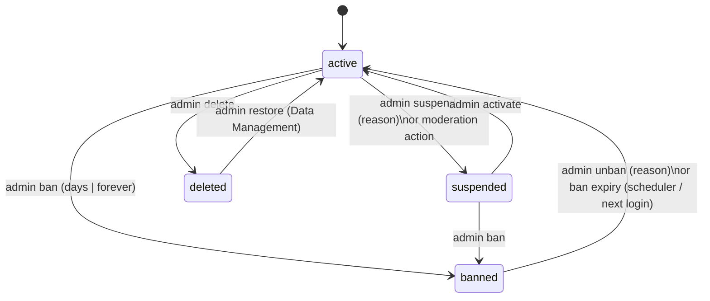

# Account Status Lifecycle

`users.status`: mobile accounts use `active, suspended, banned`; administrators use
`active, inactive`. Deletion is a **soft delete** (`deleted_at`), not a status
([[ADR-009 No Account Deactivation]]).

| Transition | Endpoint | Guards (from actions) |
|---|---|---|
| suspend | `PATCH /api/users/{u}/suspend` | not already suspended; a banned account cannot be suspended |
| activate | `PATCH /api/users/{u}/activate` `{reason?}` (note passed on) | a banned account cannot be activated (use unban) |
| ban | `PATCH /api/users/{u}/ban` `{duration: days|forever, days, reason}` | not already banned; clears suspension fields; `banned_until` null = permanent |
| unban | `PATCH /api/users/{u}/unban` `{reason}` | — |
| delete | `DELETE /api/users/{u}` `{reason}` | reason required; not yourself; not already deleted; revokes all tokens; the reason is stored (`users.deletion_reason`), emailed (`UserDeletedMail`) and shown on the app's sign-out screen |
| provider suspend / activate | `PATCH /api/providers/{p}/suspend` · `/activate` | also suspends / reactivates the provider's account (a banned account stays banned). A report decision that suspends a provider also marks the profile suspended, so Provider Management shows it and its Activate restores both |
| provider unban | `PATCH /api/providers/{p}/unban` `{reason?}` | account banned (bans come from report moderation); a suspended profile stays suspended — activate separately |
| provider delete | `DELETE /api/providers/{p}` | **409** while the provider has open bookings (pending, confirmed, active, disputed), an open refund (due, sent, not received) or outstanding commission; soft-deletes the account, revokes access and refresh tokens; the profile and history stay |
| self-delete | removed 2026-10-14 — `DELETE /api/client/v1/auth/me` answers **410** ([[ADR-023 Refunds After Cancellation and No Self-Deletion]]) | — |
| ban expiry | `users:unban-expired` (every minute) + on login | `banned_until` in the past |

Administrators: `PATCH /api/administrators/{id}/status {active|inactive}`; inactive admins cannot
sign in ("Your account has been deactivated…").

## What a restricted user experiences

- **Signed out at once:** the moment an account is suspended, banned or deleted (from any module —
  User Management, Provider Management, report moderation) `PushAccountRestriction` (a listener on
  the `User` model's `updated` / `deleted` events) broadcasts `.client.account.restricted`
  `{account: {status, reason, since, until}, message}` on `private-App.Models.User.{id}` after commit
  (`status` is `deleted` for a removed account). The open app ends its session and the login screen
  shows the restriction card. Best effort: an app that missed it (closed, offline) is refused on its
  next request instead ([[Realtime Channels and Events]]).
- Every refusal (login, Google, OTP, refresh, mobile middleware) is **403** with
  `meta.account {status, reason, since, until}` (`AccountRestrictedException`).
- `/auth/me` includes `account` and the provider's suspension details.
- The app ends the session and explains why on the login screen; Settings shows an account status
  card ([[Mobile Security]]).
- Warned / suspended / reactivated users get a notification (`NotifyUserOfAccountAction`); banned /
  unbanned users get an email (`SendUserModerationMail`, best effort, gated by the email setting).

Provider suspension sets `provider_profiles.suspended_at` (hides the provider from the marketplace)
**and** suspends the account, so the provider is signed out and cannot sign in until activated
(owner decision 2026-10-15) — see [[Provider Verification Lifecycle]]. Providers suspended before
then were given the same account suspension by migration `2026_10_15_000001`.

## What the provider's customers experience

When a provider is suspended, banned or deleted (any path), `TellCustomersAboutProvider` (a
listener on the `User` model) notifies every customer with an **open** booking (`Booking::OPEN_STATUSES`:
pending, confirmed, active, disputed) — `ProviderStandingNotification`, type
`booking_provider_status`, never muted — and pushes `.client.booking.changed` so open booking
screens reload. Reinstating the provider sends *"… is available again"*.

The customer's booking (`provider.account_status`, `provider.account_notice`) and chat
(`counterpart.account_status`, `counterpart.account_notice`) say why, worded in one place
(`ProviderStandingPresenter`). On an open booking the notice says it can be cancelled with **no
cancellation fee** ([[Cancellation and Fees]]) and to contact support if they already paid; on a
finished one it states the fact. The app shows a red banner on booking details and in the chat, and
a *Provider suspended* line on booking cards.

Related: [[User Management]] · [[Data Retention and Deletion]] · [[users]]
