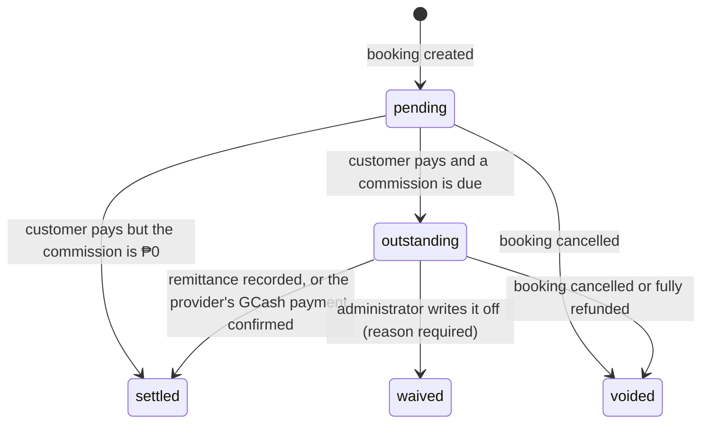
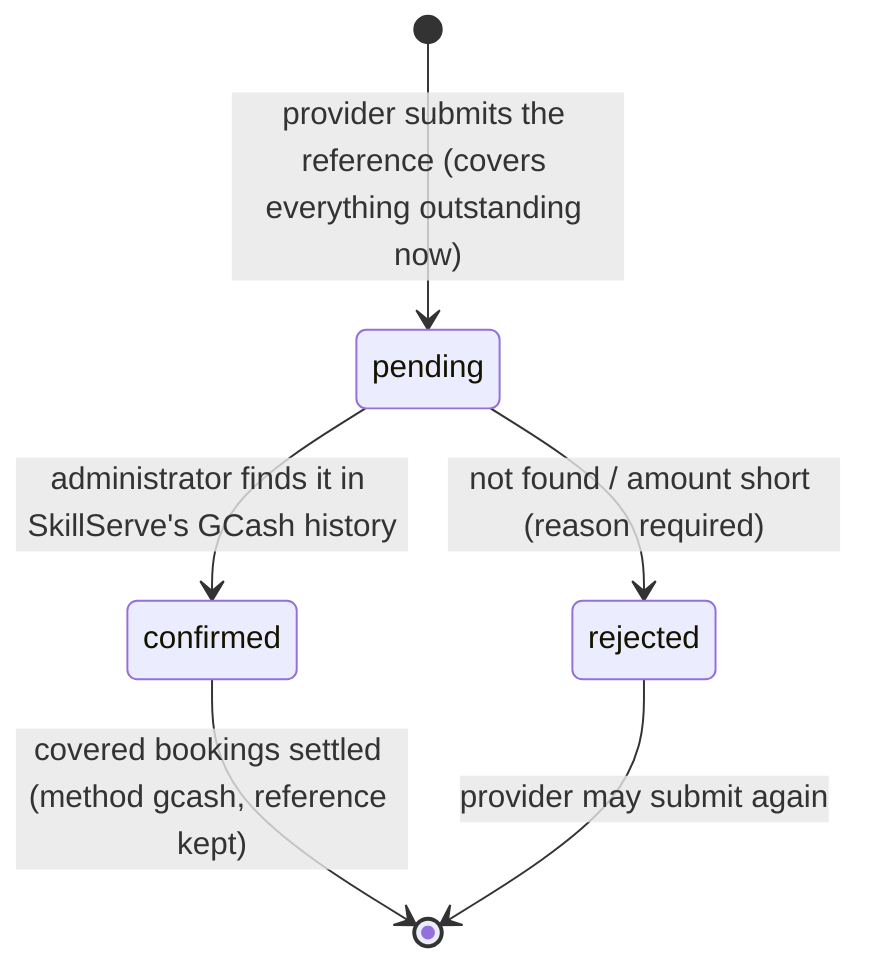
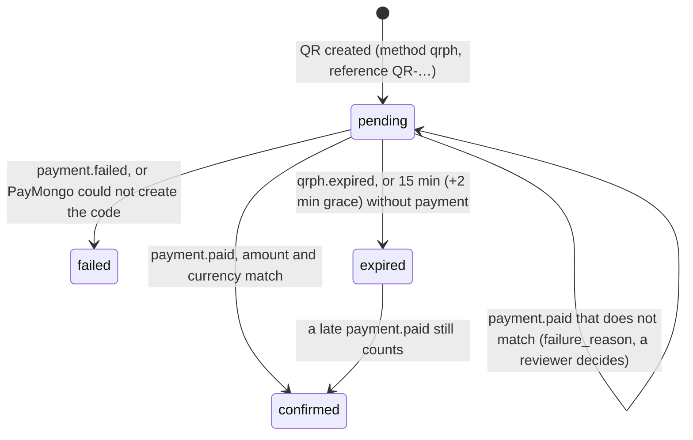

# Commission Tiers and Settlement

SkillServe's commission is **inclusive**: it is contained within the price the provider advertises,
never added on top of it. A ₱200 service at a 10% band means the customer pays **₱200**, SkillServe's
share is **₱20**, and the provider receives **₱180**.

This is why `bookings.total_price` equals `service_price` and `platform_fee` is recorded beside it
rather than added to it — the contract the mobile app already relies on.

## Tiers

`commission_tiers` holds the bands an administrator configures. Both bounds are **inclusive**, and a
NULL `max_amount` is the open-ended top band, so the configuration reads exactly as the business
states it:

| min_amount | max_amount | percentage |
|---|---|---|
| 0 | 199.99 | 5 |
| 200 | 499.99 | 10 |
| 500 | 999.99 | 15 |
| 1000 | *(null)* | 20 |

Two **active** bands may never claim the same peso amount, or the rate charged would depend on row
order. `CommissionTierService` refuses an overlap on every driver; on PostgreSQL an exclusion
constraint (`commission_tiers_no_active_overlap`, `EXCLUDE USING gist` over
`numrange(min_amount, max_amount, '[]')` `WHERE (is_active AND deleted_at IS NULL)`) enforces it in
the database too, which is what closes the race between two administrators saving at once. Disabled
and soft-deleted bands are exempt — they charge nobody.

## Presets

`config/commissions.php` holds ready-made tier sets an administrator can apply in one step from
the dashboard ([[Admin Dashboard]]):

| Key | Name | Bands |
|---|---|---|
| `standard` | Standard | the four bands in the table above (5 / 10 / 15 / 20%) |
| `flat_10` | Flat 10% | one open-ended band from ₱0 at 10% |

Applying a preset (`CommissionTierService::applyPreset`) runs in one transaction: every **active**
tier is retired (soft-deleted, firing `CommissionTierDeleted` as a manual retirement would), then the
preset's bands are created through the normal overlap-checked `store()` path (firing
`CommissionTierCreated`), so the audit log shows exactly what changed. Disabled tiers are left alone.
Bookings already made keep their snapshot. Adding a preset is a config change; each preset must
cover every amount from ₱0 without overlaps.

## Which rate applies

`CommissionCalculator` is the single authority. The client never calculates a commission.

| Situation | Rate | `source` |
|---|---|---|
| An active band covers the amount | that band's percentage | `tier` |
| Bands exist but none covers the amount | **0%**, and the gap is logged | `gap` |
| No active bands at all | `marketplace.commission_rate` (legacy flat setting) | `fallback` |

The `fallback` path is what makes the deploy a no-op until tiers are configured.

## Snapshotting

`CreateClientBookingAction` writes `platform_fee`, `commission_rate` and `commission_tier_id` onto
the booking when it is made. Historical bookings therefore **never move** when an administrator
changes the tiers afterwards.

## Settlement

Because the commission is inclusive, a provider paid in cash for an on-hand job has collected
SkillServe's share along with their own and owes it back. `bookings.commission_status` tracks that.

- Becoming outstanding is driven by **payment**, not completion: `BookingPaymentService::markPaid`
  calls `CommissionLedger::markOutstanding`. A booking carrying no commission settles itself, so no
  provider is blocked over ₱0.
- A **full** refund voids the commission; a partial one leaves it alone. A commission already
  settled is never reopened — reversing that is a refund decision of its own.
- Cancellation voids it, via `VoidCommissionOnCancellation` listening to `BookingCancelled`.
- Settling or waiving notifies the provider (`NotifyProviderOfCommissionSettlement`), including what
  they still owe, so they know at once whether they can take new work.
- `commission_settlements` is one row per booking (unique on `booking_id`), recording amount, method
  (`gcash`, `bank_transfer`, `cash`, `offset`, `other`), reference and who recorded it. The amount is
  always taken from the booking, never from the request.

## Paying it by GCash

> [!warning] Retired 2026-10-11
> Providers now pay only by QR Ph (below). `POST /api/client/v1/provider/commission-remittances`
> answers **410** ("update the app and pay with a QR code"), and System Settings → Commission
> payments (SkillServe's GCash name and number) was removed. Payments already submitted this way
> are still reviewed exactly as described here.

Before it was retired: SkillServe's GCash was shown on the provider's Commission screen; the
provider sent the money outside the app, tapped **I've paid** and submitted the GCash reference
number, the amount sent and, optionally, a receipt screenshot.

| Rule | Where |
|---|---|
| A submission settles **nothing**; the provider stays blocked until it is confirmed | `CommissionRemittanceService::submit` |
| It covers every booking outstanding **at submission**, snapshotted with its amount; later debts are not part of it | `commission_remittance_bookings` |
| `amount_sent` must be at least what is owed (422 otherwise) | service |
| One pending claim per provider (409 for a second) | service + partial unique index |
| A reference can be **confirmed** only once: submitting an already-confirmed reference is 422, confirming a second claim on it is 409 | service + partial unique index `commission_remittances_reference_confirmed` |
| Pending claims **may** share a reference — otherwise whoever typed someone else's receipt first would lock the real payer out. The reviewer sees `other_claims_count` and checks the sender | `countOtherClaims()` |
| The reference is compared without spaces or dashes, upper-cased | `SubmitCommissionRemittanceRequest` |
| Confirming settles each covered booking still outstanding through `CommissionLedger::settle` with `commission_remittance_id`; one waived, voided or settled by hand meanwhile is skipped | `confirm()` |
| The provider gets **one** notification per decision (`commission_remittance`), not one per booking settled | `NotifyProviderOfRemittanceDecision`; `NotifyProviderOfCommissionSettlement` skips remittance settlements |
| Receipts sit on the private `commission_remittances` disk; reviewers open them through an authorized download, which is written to the audit log | `GET /api/commission-remittances/{id}/proof` |
| Receipts of decided payments are deleted 180 days after the decision (`RECEIPT_RETENTION_DAYS`); the payment and its reference are kept | `commissions:purge-receipts`, daily |

The provider app reloads the balance and the eligibility banner as soon as a `commission_remittance`
or `booking_commission` notification arrives (`CommissionController`), so a confirmation lifts the
block on screen without a pull to refresh.

## Paying it by QR Ph

When PayMongo keys are configured (`payment_account.qr_payments_available`), the provider can tap
**Pay with QR code** instead. `CommissionQrPaymentService` creates a PayMongo Payment Intent for the
exact outstanding total (`payment_method_allowed: [qrph]`), a `qrph` Payment Method, and attaches
it with `expiry_seconds` 900 (15 minutes; PayMongo's default is 30); the QR image comes back in
`next_action.code.image_url`.

Since 2026-10-11 the app offers **only** this way to pay the commission. The GCash-reference
endpoints below still answer — an older app version may use them, and an administrator still
reviews what arrives that way — but the current app has no "I've paid" form. The money is SkillServe's own
commission, so this is not escrow ([[ADR-022 Payment QR Codes Without Holding Customer Money]]).

| Rule | Where |
|---|---|
| The amount is the server's outstanding total in centavos; nothing the app sends is used | `start()` |
| Asking again while a code is payable returns that code (200), never a second one | `start()` + one-pending index |
| No lock is held across the PayMongo calls; a failure closes the attempt as `failed` (502) and it can be retried | `start()` |
| Only the signed webhook settles, and only when `amount` and `currency` match; redeliveries are no-ops (`last_event_id`) | `applyWebhook()` |
| Settlements are written with method `qrph`, recorded by the payer (no administrator is involved) | `settleCovered()` |
| A QR code waiting to be scanned is not in the reviewers' queue or the sidebar count; a mismatched one is | `CommissionRemittance::needsReview()` |
| One open payment per provider across **both** methods (409 otherwise) | both services |

It is the only way to pay in the app: without keys the provider is told to contact support.

Waiting claims are counted on the admin sidebar (`pending_commission_remittances` in
`GET /api/dashboard/attention`) and update live (`commission-remittances` realtime resource).

## What an outstanding commission blocks

Enforced by `TransactionEligibility`, the one place the rule lives, so mobile and admin web inherit
identical behaviour from the API.

| Action | Blocked while outstanding? |
|---|---|
| Accept (confirm) a new booking | **Yes** |
| Create or edit a service | **Yes** |
| Start / complete an agreed job | No |
| Decline / cancel | No |
| Anything the **customer** does | No — never |

**When the block starts** is set in System Settings → Marketplace. It applies once *either*

- the unpaid total reaches `commission_block_min_amount` (₱; **0 = any debt**), or
- the oldest unpaid commission — dated by the booking's `paid_at` — is older than
  `commission_block_after_days` (**0 = off**).

The defaults (₱0, off) block on any debt at once, the original rule. `forProvider()` reports
`block_threshold` and `block_deadline` alongside `outstanding_total`, so the app can warn a provider
before they are stopped — and it does: while something is owed but not yet blocking, the app's
Commission screen shows an amber notice, "new jobs and services pause on {deadline}, or once it
reaches ₱{threshold}, whichever comes first" (`CommissionSummary.warnsBeforeBlock`).

Work the provider has already agreed to is deliberately never blocked: a customer who is already
booked must not be stranded by a debt between the provider and the platform, and a provider paid up
front would otherwise be unable to begin the very job that put them in debt.

## Endpoints

| Surface | Endpoint | Permission |
|---|---|---|
| Admin | `GET/POST/PUT/PATCH/DELETE /api/commission-tiers` | `view commissions` to read, `manage commissions` to change |
| Admin | `GET /api/commission-tiers/presets` | `view commissions` |
| Admin | `POST /api/commission-tiers/presets/{preset}/apply` | `manage commissions` |
| Admin | `GET /api/commissions` (+ `meta.totals`) | `view commissions` |
| Admin | `PATCH /api/commissions/{booking}/settle` · `/waive` | `settle commissions` |
| Provider | `GET /api/client/v1/provider/commission-preview?amount=` | provider account |
| Provider | `GET /api/client/v1/provider/commissions` (+ `payment_account`, `latest_remittance`) | provider account |
| Provider | `GET/POST /api/client/v1/provider/commission-remittances` · `GET …/{id}` | provider account |
| Provider | `POST /api/client/v1/provider/commission-remittances/qr` (10/min) | provider account |
| Admin | `GET /api/commission-remittances` · `GET …/{id}/proof` | `view commissions` |
| Admin | `PATCH /api/commission-remittances/{id}/confirm` · `/reject` | `settle commissions` |

Providers also see an `earnings` block on each of their services and `commission_rate` / `net_amount`
on each of their bookings, so the split is visible before they publish a price.

> [!note] Settlement is recorded, not processed
> No payment gateway is called. The provider's GCash payment is confirmed by an administrator once it
> arrives (or a remittance is recorded by hand), exactly as booking payments are. See
> [[ADR-007 Payments Recorded Not Processed]].

Related: [[Payments and Refunds]] · [[Booking Lifecycle]] · [[System Settings Catalog]] ·
[[bookings]] · [[commission_remittances]] · [[Cancellation and Fees]] ·
[[ADR-022 Payment QR Codes Without Holding Customer Money]] · [[PayMongo Setup]]

## What the provider is shown per booking

`CommissionLedger::breakdownFor()` returns `earnings` on every provider booking
(`GET /client/v1/provider/bookings[/{id}]`): `price`, `commission_rate` (recorded at booking time),
`commission`, `provider_receives` and the `commission_status`. A waived share leaves the whole price;
a voided (cancelled) booking earns and owes nothing. The app shows it as **Your earnings** on Booking
Details and never computes it.

