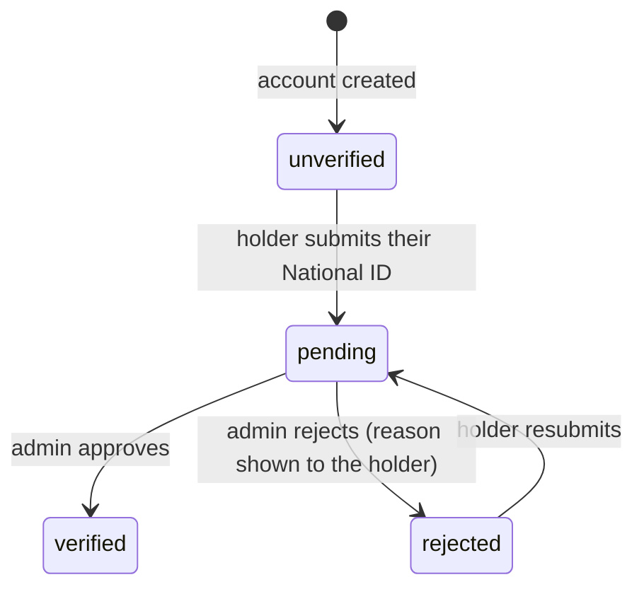

# Identity Verification Lifecycle

Philippine National ID (PhilSys) verification for **customers and providers alike**. It proves who
an account holder is, and gates *transacting*.

> [!important] Not the same thing as provider verification
> [[Provider Verification Lifecycle]] proves a provider is a legitimate tradesperson (documents,
> business details) and gates *publishing services*. Identity verification proves who someone is and
> gates *booking, accepting work and paying*. They are reviewed independently and stored separately,
> which is what lets existing verified providers keep working without being pushed through a new
> queue.



## Storing the card number

The PhilSys Card Number is **never stored in the clear**.

| Column | What it is for |
|---|---|
| `id_number_hash` | HMAC-SHA256 of the normalised 16 digits under a server-side pepper. The only column ever compared, and the only one a unique index can use. |
| `id_number_encrypted` | Laravel `encrypted` cast; lets an administrator settle a disputed match. Cleared on release. |
| `id_number_last4` | The only part ever displayed, in the app or the admin queue. |

The pepper (`config('identity.hash_key')`, env `IDENTITY_HASH_KEY`, defaulting to `APP_KEY`) is what
makes the scheme work: the card-number space is only 10¹⁶, so a plain hash could be enumerated by
anyone holding the database. It must stay stable for the life of the database — see
[[ADR-018 Blind Index for National ID Uniqueness]].

Input is normalised to digits before hashing, so `1234-5678-9012-3456`, `1234 5678 9012 3456` and
the bare digits are one identity. Without that, the same person could hold several accounts simply
by typing their number differently.

## One National ID = one provider account + one customer account

Owner decision 2026-10-15 (was: one account of any kind). A person may both hire and offer
services, but never hold two provider — or two customer — accounts on one ID. Each record carries
`account_type` (`provider` / `customer`, fixed at sign-up), and only a **pending or verified**
submission holds the ID: a rejected one is not a claim, so a stranger who tried someone's card
cannot lock the real owner out (its hash stays on file for review).

Enforced in the database, not only the application, by a partial unique index:

```sql
CREATE UNIQUE INDEX identity_verifications_active_id_number_per_type
ON identity_verifications (id_number_hash, account_type)
WHERE id_number_hash IS NOT NULL AND released_at IS NULL AND status IN ('pending', 'verified')
```

Checked at two moments, with the same message (`IdentityVerification::idInUseMessage`) — *"A
provider account already uses this National ID. One National ID can verify only one provider account
and one customer account."* (or *customer*). It names the kind of account, never which one:

1. **Sign-up** — the app sends the scanned card number as `id_number` with `register`,
   `register-provider` and `google/register`; `NationalIdAvailable` refuses the sign-up (422 on
   `id_number`) before any account exists. The number is only checked there, never stored. Older
   apps that send no number skip this step.
2. **Submission** — `POST /identity-verification` re-checks under a row lock; the index above closes
   the remaining race.

Both PostgreSQL and SQLite support partial indexes, so the rule is exercised by the test suite as
well as in production.

**Release happens on permanent deletion only.** A soft-deleted account can be restored for 30 days
([[ADR-016 Soft Delete with 30-Day Purge]]); releasing the ID earlier would let a second account
claim it and leave two live accounts on one ID after that restore. `DataManagementService::forceDelete`
is where the release is triggered.

On release the record **survives** with `user_id` nulled — it is the audit trail for a decision the
platform made about a person — while the encrypted number and the images are dropped. The hash is
kept deliberately: it is pseudonymous, irreversible without the pepper, and is what lets the platform
recognise a previously-removed ID.

## Enforcement

Off by default. Two settings decide whether an account is covered (`IdentityGate`):

| Setting | Effect |
|---|---|
| `identity_verification_required` | Master switch. **False by default**, so deploying changes nothing. |
| `identity_verification_enforced_from` | Grandfathering date. Accounts created before it keep transacting unverified; accounts created on or after it must verify. **Empty means everyone**, which freezes existing users until the queue is cleared. |

What an unverified (but covered) account can and cannot do:

| Action | Allowed unverified? |
|---|---|
| Register, sign in, browse, search, view services and providers | **Yes** |
| Manage own profile / provider profile | **Yes** |
| Create a booking (customer) | No |
| Accept a booking, publish or edit a service (provider) | No |
| Transaction chat | Booking chats are implicitly gated (the booking cannot be created); chat before booking is open, since asking questions is not a transaction |

`TransactionEligibility` is the single place these rules live, so the Flutter app and the React admin
inherit identical behaviour from the API rather than each implementing it. `GET /api/client/v1/transaction-eligibility`
lets the app *explain* a refusal; it is advisory, and every protected action re-checks server-side.

## Where each surface shows this

| Surface | Screen |
|---|---|
| Mobile, both roles | `/identity-verification` — captures both sides of the card and the number, shows the review state and a rejection reason, and offers "I'll do this later" only while the requirement does not cover that account. Reached from the Profile tab and, for a new account, straight after the OTP. |
| Mobile, both roles | `EligibilityBanner` on the customer home and the provider dashboard: renders the eligibility `reason` as a prompt that opens the screen which fixes it, and draws nothing at all while the account is eligible. |
| Mobile, provider | `/commissions` for `outstanding_commission`, which is the other thing that stops a provider transacting. |
| Admin web | System Settings → **Identity** (the master switch, the cutover date and the retention days) and the Identity Verifications review queue. |

Turning the requirement on with the cutover date empty applies it to **every existing account**, so
the settings page warns about that before it is saved.

## Documents and retention

Images (`id_front`, `id_back`, `selfie`; JPG/PNG/PDF ≤10 MB) live on the private `identity` disk with
random UUID filenames, and are never reachable by URL. A photo of the front or back must be at
least 800 × 500 px in either orientation (422 otherwise); the app also refuses dark, washed-out and
unreadably blurry photos and takes them without filters ([[Mobile Identity Verification]]). An administrator opens one through an
authorised, audited download that verifies the document belongs to the submission in the path.

A **verified** ID keeps its images while the account exists (owner decision, 2026-10-14), so an
administrator can still look at it when a fraud or dispute question comes up later; they show on the
provider's profile (*National ID* card) and in the review queue. A **rejection** starts the retention
clock (`documents_purge_after`); `identity:purge-documents` (daily) then deletes those images while
keeping the decision and its history, and skips verified records even if an older one still carries a
date. Retention is System Settings → Identity → *Keep rejected National ID images for (days)*,
default 90. Images purged before this change cannot be recovered.

## Endpoints

| Surface | Endpoint | Permission |
|---|---|---|
| Holder | `GET/POST /api/client/v1/identity-verification` | active, email-verified mobile account; POST is rate limited (5/hour/user) |
| Holder | `GET /api/client/v1/transaction-eligibility` | same |
| Admin | `GET /api/identity-verifications` · `/{id}` | `view identity verifications` |
| Admin | `PATCH /{id}/approve` | `verify identities` |
| Admin | `PATCH /{id}/reject` (reason required) | `reject identities` |
| Admin | `GET /{id}/documents/{doc}/download` | `view identity verifications` (audited) |

## Deliberate non-features

- **The card number is not searchable.** Hashing a search term would turn the admin queue into a
  "does SkillServe know this ID?" oracle for anyone holding a stolen card.
- **The duplicate-ID refusal does not name the holding account**, for the same reason.
- **No external verification provider is integrated.** There is no public self-service PhilSys API
  for private developers; approval is a human reviewer reading the ID image. `IdentityGate` and the
  review flow are structured so a KYC vendor could later replace the manual decision without the
  enforcement rules changing.

Related: [[Provider Verification Lifecycle]] · [[Commission Tiers and Settlement]] ·
[[Data Retention and Deletion]] · [[identity_verifications]] · [[System Settings Catalog]] ·
[[ADR-018 Blind Index for National ID Uniqueness]]
