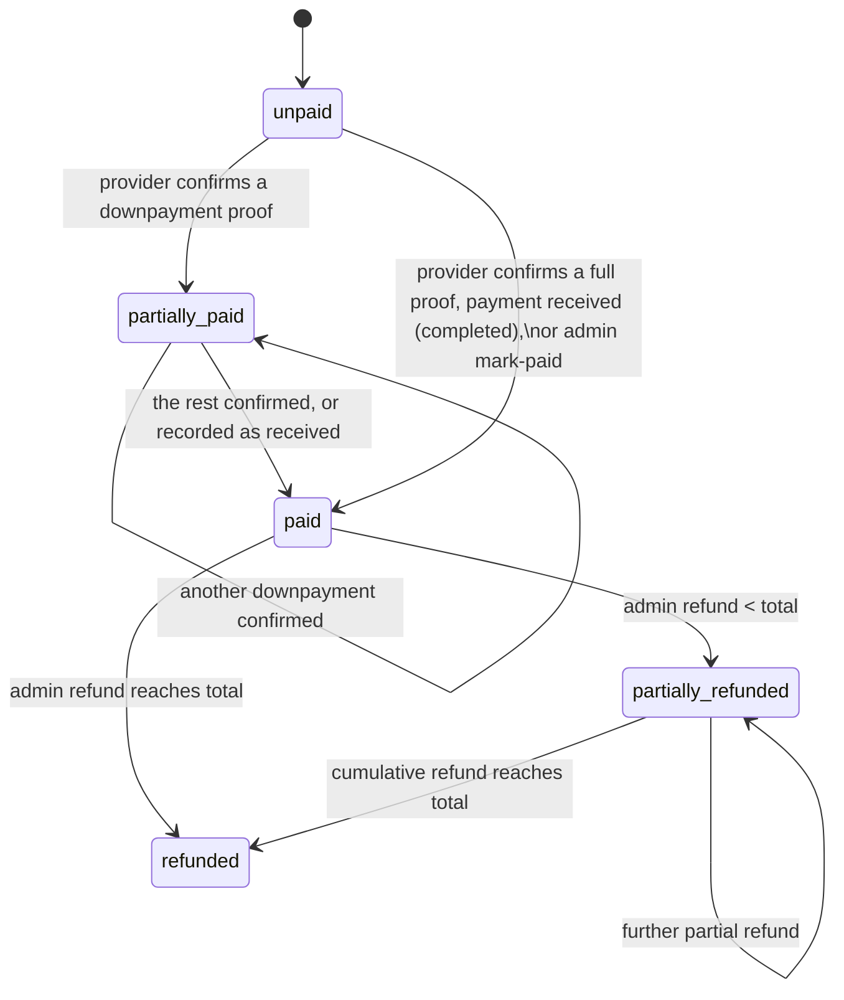

# Payments and Refunds

SkillServe **records** payments; it never processes cards or moves money. Customers pay providers
off-platform (cash, GCash, …). See [[ADR-007 Payments Recorded Not Processed]].

`bookings.payment_status` ∈ `unpaid, partially_paid, paid, partially_refunded, refunded`;
`bookings.amount_paid` adds up what has been confirmed (downpayments included).

## Payment methods

Exactly two, as `App\Modules\Bookings\Enums\PaymentMethod`:

| Value | Meaning |
|---|---|
| `on_hand` | Paid directly to the provider, in person |
| `gcash` | Paid through GCash, to the **provider's own number** — recorded by hand |

`cash` is still accepted on input as a deprecated alias for `on_hand` and is canonicalised on the way
in. `credit_card`, `debit_card`, `bank_transfer` and `paypal` were removed and are now rejected with
422. Bookings created before the change keep their stored value as display-only history.

The mobile app was brought into line on 2026-09-26: the booking form offers `on_hand` and `gcash`
only, and a booking made by an older build still displays whatever method it was stored with.

Which gateway handles a method is configuration (`config/payments.php`), and **both are mapped to
the manual gateway unconditionally** — configuring `PAYMONGO_SECRET_KEY` does not change that. See
below.

## How money actually moves

**SkillServe is never in the payment path.** The customer pays the provider directly — GCash to the
provider's own number, or cash on the job — and the provider then owes SkillServe its commission,
which they must remit to keep taking work. See
[[ADR-021 Direct Payment with Provider-Remitted Commission]].

Both payment methods therefore route to the **manual** gateway unconditionally, even when PayMongo
credentials are configured. A GCash booking is settled exactly like a cash one, and its commission
becomes `outstanding` the same way.

The customer sees the provider's GCash details as `payment_instructions` on their own booking —
number, account name, amount and the booking number to use as a reference. They appear only while
the booking is an unpaid GCash job, and never in the public catalog: they are the provider's
personal payment details.

`gcash_name` is shown alongside the number so the customer can check it against the recipient name
GCash displays before confirming — that is what catches a mistyped number.

**The provider's QR with the exact amount.** A provider can save their own GCash "Receive via QR"
code (`provider_profiles.gcash_qr_payload`, read on the phone). `payment_instructions.qr_payload` is
then a copy of it with the booking's total written in (`QrPh::withAmount`: EMV tag `54`, marked
dynamic, CRC recomputed); the app draws it and lets the customer save it for GCash's *Upload QR*.
The account fields are untouched, so the money still goes straight to the provider — see
[[ADR-022 Payment QR Codes Without Holding Customer Money]].

## GCash payment proofs (downpayment and the rest)

The customer can tell the provider what they sent and prove it: **I've paid — send proof** on their
own GCash booking (`POST /api/client/v1/bookings/{id}/payment-proofs`, multipart: `amount`,
optional `reference`, `image` screenshot). Then:

- **When:** once the booking is accepted (`confirmed, active, completed, disputed`), while something
  is owed (`unpaid` / `partially_paid`), GCash bookings only. **One proof waits at a time** (409).
- **Amount:** 1 … `balance_due`. Less than the balance is a **downpayment**; the app offers *Full*
  and *Half* and says what will remain.
- **Provider:** sees the screenshot (private disk `payment_proofs`, streamed after authorisation)
  and **confirms** (`PATCH …/provider/bookings/{id}/payment-proofs/{proof}/confirm`) or **rejects**
  with a reason (`…/reject`) — before or after the work. Confirming more than is still owed is
  refused (409); reject it instead.
- **Effect of confirming:** `BookingPaymentService::receive()` adds the amount: below the total →
  `partially_paid`; reaching it → `paid` (`paid_at`, `payment_recorded_by`, the proof's reference)
  and the commission becomes **outstanding**, exactly as for any paid booking.
- **Who hears:** the provider on a new proof (`payment_proof` / `submitted`); the customer on a
  rejection (`payment_proof` / `rejected`, with the reason) and on a confirmation (`booking_status`
  `partially_paid` "Downpayment confirmed" or `paid` "Payment complete").
- **Live:** every payment, proof and status change also pushes `client.booking.changed` to both
  parties, so open booking screens reload at once — independent of notification settings.
- **Admins** see *Paid so far* and every proof with its screenshot in the booking dialog
  (`GET /api/bookings/{id}/payment-proofs/{proof}/image`).

`payment_instructions.amount` and its QR carry the **balance**, not the total, after a downpayment.
Table: [[booking_payment_proofs]].

## Refunds after cancellation

A cancelled booking with money paid on it opens a refund the provider must return — see
[[ADR-023 Refunds After Cancellation and No Self-Deletion]] and [[booking_refunds]]. Endpoints:
provider `POST /client/v1/provider/bookings/{id}/refund` (screenshot), customer
`PATCH /client/v1/bookings/{id}/refund/confirm` · `/refund/not-received` (note), admin
`PATCH /api/bookings/{id}/refund/resolve` (`returned` | `not_returned`, note; `manage booking
payments`). Confirming (or *returned*) adds to `refunded_amount`; `payment_status` becomes
`refunded` (or `partially_refunded` when less than was paid comes back). Unreturned refunds block
the provider (`refund_overdue`).

> [!warning] No escrow, no payment guarantee
> Because the platform never holds the money, it cannot reverse a payment. A customer who pays and
> receives nothing, or a provider who works unpaid, is a dispute — not something SkillServe can
> undo. That is the trade accepted for not handling other people's money.

## PayMongo (built, not used for bookings)

> [!warning] No booking is payable online, and the app has no "Pay now" button
> `POST /api/client/v1/bookings/{booking}/pay` resolves the booking's method to its gateway, finds
> the manual one, and refuses with a **422** — for every booking, with or without credentials. No
> payment intent is ever created. The endpoint is kept because the mapping is configuration rather
> than code. PayMongo's one real use is a provider paying their **own** commission by QR Ph —
> SkillServe collecting its own revenue — see [[Commission Tiers and Settlement#Paying it by QR Ph]].

Were a method ever routed to a collecting gateway, the endpoint would start a payment on the
customer's own unpaid booking once the provider had accepted it, return `redirect_url`, and resume
the same attempt when tapped again.

PayMongo's flow: create a Payment Intent → create a `gcash` Payment Method → attach → redirect the
customer → `payment.paid` / `payment.failed` webhook.

> [!important] The webhook marks the booking paid, never the return redirect
> The customer's return from the payment page is a browser navigation anyone can forge by visiting
> the URL. `POST /api/webhooks/paymongo` verifies `Paymongo-Signature` against the **raw** body
> before parsing, and is the only thing that records payment.

Were PayMongo ever used for a booking it would settle into SkillServe's account, so the GCash
commission would be **settled on payment** rather than becoming outstanding — and SkillServe would
then owe the provider their net, with no mechanism to pay it. That is exactly why the mapping is
fixed to manual. See [[ADR-020 PayMongo Collects Into the Platform Account]] and
[[ADR-021 Direct Payment with Provider-Remitted Commission]].

| Action | Who | Endpoint | Allowed booking status | Permission |
|---|---|---|---|---|
| Payment received | provider | `PATCH /api/client/v1/provider/bookings/{id}/payment-received` (optional reference) — records whatever is still owed | `completed` | provider owns booking |
| Send payment proof | customer | `POST /api/client/v1/bookings/{id}/payment-proofs` | `confirmed, active, completed, disputed`; GCash; owing | customer owns booking |
| Confirm / reject proof | provider | `PATCH /api/client/v1/provider/bookings/{id}/payment-proofs/{proof}/confirm` · `/reject` (reason) | any; proof pending | provider owns booking |
| Mark paid | admin | `PATCH /api/bookings/{id}/mark-paid` | `confirmed, active, completed, disputed` (`PAYABLE_STATUSES`) | `manage booking payments` (or `manage bookings`) |
| Refund | admin | `PATCH /api/bookings/{id}/refund` (amount, reason) | booking must be `paid`/`partially_refunded` | `manage booking payments` |

Rules (`BookingPaymentService`):
- Mark paid requires something owed (`unpaid` / `partially_paid`, else **409** "already marked as
  paid") and records the **balance**; sets `amount_paid = total_price`, `paid_at`,
  `payment_recorded_by`, `payment_reference`.
- Refunds accumulate in `refunded_amount`; over-refunding is refused; status becomes `refunded` when
  the total reaches `total_price`, else `partially_refunded`; sets `refunded_at`, `refund_reason`.
- Every change fires `BookingPaymentRecorded` → audit log + `NotifyPaymentParticipants` (the other
  party is notified).

The mobile **Payments** screens (customer) and **Earnings** screen (provider) derive their data from
bookings — there is no payments table or endpoint.

> [!note] The commission is settled separately
> Recording a booking as paid also makes the provider's commission **outstanding**, because the
> commission is included in the price they were paid. See [[Commission Tiers and Settlement]].

Related: [[booking_payment_proofs]] · [[Commission Tiers and Settlement]] · [[Booking Lifecycle]] · [[Booking Management]] · [[Client Payments View]] ·
[[Provider Earnings and Statistics]]
