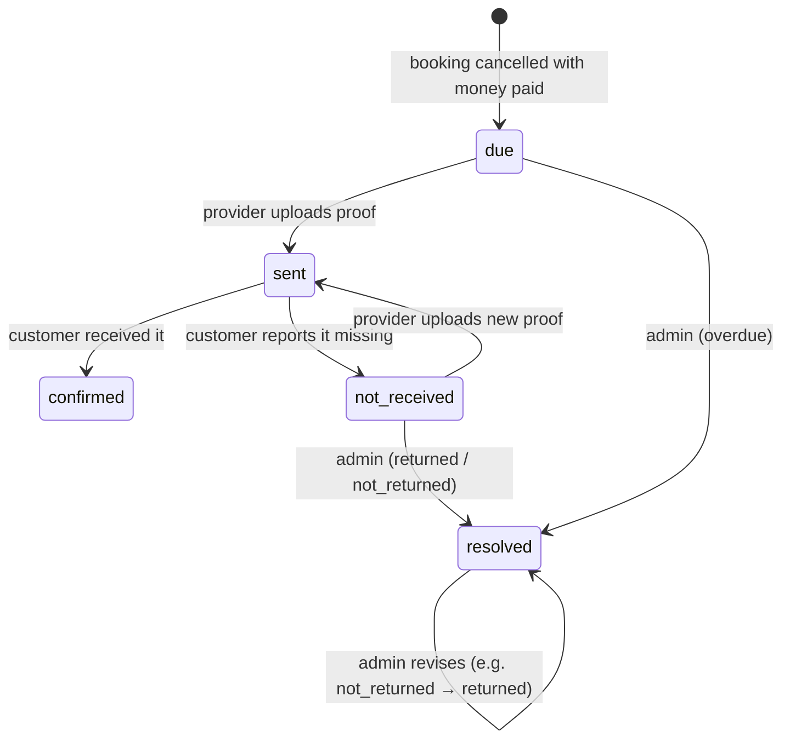

# booking_refunds

What the provider owes back on a cancelled booking that had been (partly) paid, and where returning
it stands. One per booking. See [[ADR-023 Refunds After Cancellation and No Self-Deletion]].

- **Model:** `backend/app/Modules/Bookings/Models/BookingRefund.php`
- **Migration:** `2026_10_14_000004_create_booking_refunds`

## Columns

| Column | Type | Notes |
|---|---|---|
| `id` | bigint PK |  |
| `booking_id` | FK bookings, unique | cascade on delete |
| `amount` | decimal(10,2) | `amount_paid` less the customer's own late fee when they cancelled late |
| `status` | string(20) default 'due' | due / sent / confirmed / not_received / resolved |
| `due_by` | timestamp | cancellation + `downpayment_refund_days` |
| `reference` | string(100) null | provider's GCash reference |
| `proof_path` | string null | provider's screenshot on the private `payment_proofs` disk |
| `sent_at` | timestamp null |  |
| `confirmed_at` | timestamp null | customer confirmed it arrived |
| `customer_note` | text null | why the customer says it did not arrive |
| `escalated_at` | timestamp null | administrators alerted (overdue or not received) |
| `resolution` | string(20) null | returned / not_returned |
| `resolution_note`, `resolved_by`, `resolved_at` |  | the administrator's decision |
| `created_at, updated_at` |  |  |

## Indexes & constraints

- unique(booking_id); index(status, due_by) — the overdue scan

## Lifecycle

**Blocking** (`BookingRefund::scopeBlocking`): `due` past `due_by`, `not_received`, or resolved
`not_returned` — the provider cannot accept bookings or publish services.

## Related

[[bookings]] · [[booking_payment_proofs]] · [[Payments and Refunds]] · [[Database Index]]
